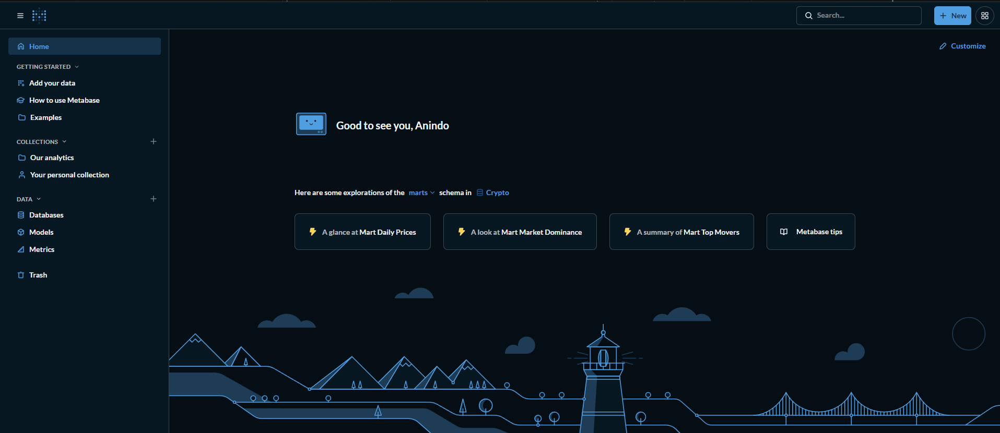
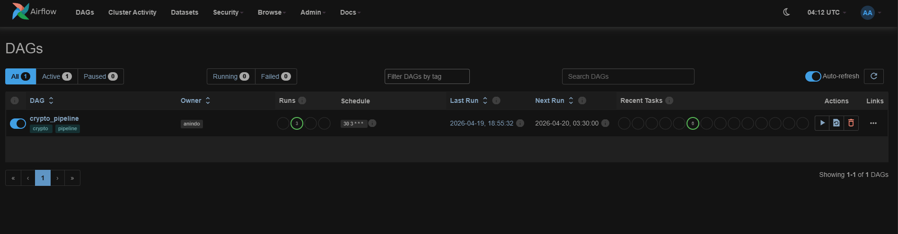

# Crypto Market Data Pipeline

A production-style data pipeline that ingests live cryptocurrency data daily,
transforms it through a layered dbt model, runs automated quality tests,
and is orchestrated by Apache Airflow — all running on Docker.

---

## Architecture

```
CoinGecko API
  ├── /coins/markets ──► Python ingestion ──► raw.coin_prices
  └── /global        ──► Python ingestion ──► raw.global_market
                                                     │
                                           dbt staging (views)
                                           stg_coin_prices
                                           stg_global_market
                                                     │
                                           dbt marts (tables)
                                           mart_daily_prices
                                           mart_top_movers
                                           mart_market_dominance
                                                     │
                                           Metabase dashboard
```

## Lineage graph


## Metabase



## Airflow



---

## Stack

| Layer | Technology |
|---|---|
| Ingestion | Python 3.12, requests, psycopg2 |
| Storage | PostgreSQL 15 (Docker) |
| Transformation | dbt-postgres 1.10, dbt-utils |
| Orchestration | Apache Airflow 2.10.5 (LocalExecutor, Docker) |
| Visualisation | Metabase (Docker) |
| Version control | Git + GitHub |

---

## Data sources

| Source | Endpoint | Frequency | Raw table |
|---|---|---|---|
| CoinGecko | /coins/markets | Daily 03:30 UTC | raw.coin_prices |
| CoinGecko | /global | Daily 03:30 UTC | raw.global_market |

---

## dbt model layers

| Model | Layer | Materialisation | Description |
|---|---|---|---|
| stg_coin_prices | staging | view | Cleaned coin price snapshots |
| stg_global_market | staging | view | Cleaned global market snapshots |
| mart_daily_prices | marts | table | Daily OHLC + 7-day rolling avg + DoD change |
| mart_top_movers | marts | table | Top 5 gainers and losers per day |
| mart_market_dominance | marts | table | BTC/ETH dominance trend with prices |

---

## Data quality

- 26 automated dbt tests run after every pipeline execution
- not_null on all key columns
- unique on surrogate keys and date columns
- accepted_values on categorical columns
- Custom singular tests: price always positive, dominance never exceeds 100%
- Source freshness check: fails if no new data in 25 hours

---

## How to run

### Prerequisites
- Docker Desktop (4GB+ RAM allocated)
- Git

### 1. Clone and configure
```cmd
git clone https://github.com/YOUR_USERNAME/crypto-pipeline.git
cd crypto-pipeline
```

Create `.env` in the project root:
```
DB_HOST=localhost
DB_PORT=5432
DB_NAME=crypto_pipeline
DB_USER=postgres
DB_PASSWORD=postgres
```

### 2. Start the database
```cmd
docker run --name crypto-db -e POSTGRES_PASSWORD=postgres -e POSTGRES_DB=crypto_pipeline -p 5432:5432 -d postgres:15
```

### 3. Set up Python environment
```cmd
python -m venv venv
venv\Scripts\activate
pip install -r requirements.txt
```

### 4. Run ingestion manually
```cmd
python main.py
```

### 5. Run dbt transformations
```cmd
cd crypto_transforms
dbt deps
dbt run
dbt test
cd ..
```

### 6. Start Airflow (automated daily runs)
```cmd
cd airflow
docker compose up airflow-init
docker compose up -d
```
Open http://localhost:8081 — login: airflow / airflow
Unpause the `crypto_pipeline` DAG. It runs daily at 03:30 UTC.

### 7. Start Metabase dashboard
```cmd
docker run -d --name metabase -p 3000:3000 metabase/metabase
```
Open http://localhost:3000 and connect to host.docker.internal:5432

---

## Project structure

```
crypto-pipeline/
├── ingestion/
│   ├── coin_prices.py       # CoinGecko /coins/markets ingestion
│   └── global_market.py     # CoinGecko /global ingestion
├── crypto_transforms/       # dbt project
│   ├── models/
│   │   ├── staging/         # stg_* views — clean raw data
│   │   └── marts/           # mart_* tables — business logic
│   ├── tests/               # custom singular tests
│   └── macros/              # generate_schema_name override
├── airflow/
│   ├── dags/
│   │   └── crypto_pipeline_dag.py
│   └── docker-compose.yml   # LocalExecutor setup
├── images/                  # screenshots for README
├── db.py                    # shared DB connection
├── logger.py                # shared logging setup
└── main.py                  # pipeline entry point (manual runs)
```

---

## Key engineering decisions

**LocalExecutor over CeleryExecutor** — CeleryExecutor distributes tasks
across multiple machines via Redis. For a single-machine pipeline it adds
operational overhead with no benefit. LocalExecutor runs tasks as
subprocesses in the scheduler — simpler, more reliable, correct for this use case.

**Idempotent inserts** — `ON CONFLICT DO NOTHING` on `(coin_id, fetched_at)`
means running the pipeline twice produces the same result as running it once.
No duplicate rows, no defensive pre-checks needed.

**dbt schema macro** — dbt's default behaviour prefixes schema names with
the profile's base schema (`public_staging` instead of `staging`). A
`generate_schema_name` macro overrides this so models write to exactly the
schema declared in `dbt_project.yml`.

**Two dbt targets** — `dev` uses localhost for local runs, `docker` uses
`host.docker.internal` for runs inside the Airflow scheduler container.
Same codebase, correct host resolution in both environments.
