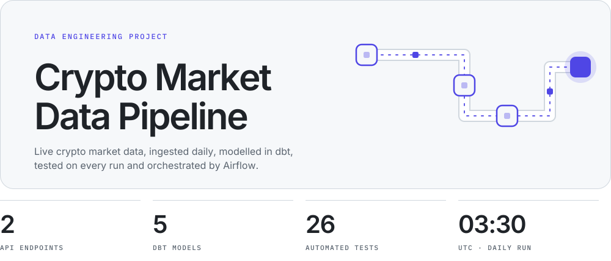
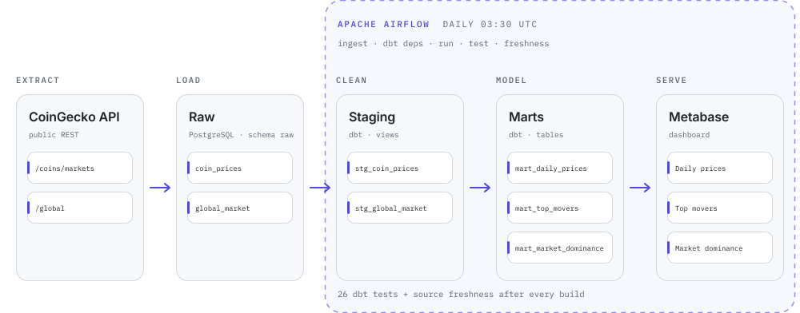
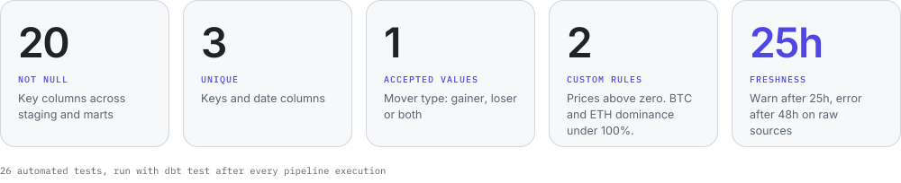
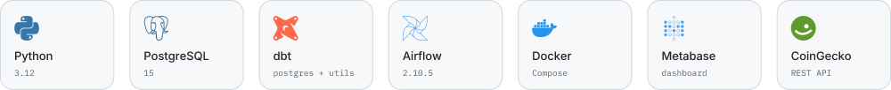

<div align="center">
<picture>
  <source media="(prefers-color-scheme: dark)" srcset="assets/hero-dark.svg">
  
</picture>
</div>

<br>

Live crypto market data from the CoinGecko API, loaded into PostgreSQL, modelled in dbt, tested on every run, orchestrated by Airflow and served in Metabase. Everything runs locally on Docker.

## Architecture

<picture>
  <source media="(prefers-color-scheme: dark)" srcset="assets/architecture-dark.svg">
  
</picture>

## Data quality

<picture>
  <source media="(prefers-color-scheme: dark)" srcset="assets/quality-dark.svg">
  
</picture>

## Stack

<picture>
  <source media="(prefers-color-scheme: dark)" srcset="assets/stack-dark.svg">
  
</picture>

## Data model

| Layer | Models | Materialisation |
|---|---|---|
| Raw | `raw.coin_prices` (top 50 coins), `raw.global_market` | Python inserts |
| Staging | `stg_coin_prices`, `stg_global_market` | view |
| Marts | `mart_daily_prices`, `mart_top_movers`, `mart_market_dominance` | table |

## Quick start

**Requires** Docker, Python 3.12 and git.

**1. Clone and configure**

```bash
git clone https://github.com/smanindokhan/crypto-pipeline.git
cd crypto-pipeline
```

Create `.env` in the project root:

```env
DB_HOST=localhost
DB_PORT=5432
DB_NAME=crypto_pipeline
DB_USER=postgres
DB_PASSWORD=postgres
```

**2. Start PostgreSQL and create the raw tables**

```bash
docker run --name crypto-db -e POSTGRES_PASSWORD=postgres -e POSTGRES_DB=crypto_pipeline -p 5432:5432 -d postgres:15
docker exec -it crypto-db psql -U postgres -d crypto_pipeline
```

```sql
CREATE SCHEMA IF NOT EXISTS raw;

CREATE TABLE IF NOT EXISTS raw.coin_prices (
    id SERIAL PRIMARY KEY,
    coin_id VARCHAR(100) NOT NULL,
    symbol VARCHAR(20) NOT NULL,
    name VARCHAR(100) NOT NULL,
    current_price NUMERIC(20, 8),
    market_cap BIGINT,
    total_volume BIGINT,
    price_change_pct_24h NUMERIC(10, 4),
    fetched_at TIMESTAMP NOT NULL,
    UNIQUE (coin_id, fetched_at)
);

CREATE TABLE IF NOT EXISTS raw.global_market (
    id SERIAL PRIMARY KEY,
    total_market_cap_usd NUMERIC(24, 2),
    total_volume_usd NUMERIC(24, 2),
    btc_dominance_pct NUMERIC(8, 4),
    eth_dominance_pct NUMERIC(8, 4),
    active_coins INTEGER,
    fetched_at TIMESTAMP NOT NULL,
    UNIQUE (fetched_at)
);
```

**3. Configure dbt** in `~/.dbt/profiles.yml` (on Windows `C:\Users\<you>\.dbt\profiles.yml`):

```yaml
crypto_transforms:
  target: dev
  outputs:
    dev:
      type: postgres
      host: localhost
      port: 5432
      dbname: crypto_pipeline
      user: postgres
      password: postgres
      schema: public
      threads: 1
    docker:
      type: postgres
      host: host.docker.internal
      port: 5432
      dbname: crypto_pipeline
      user: postgres
      password: postgres
      schema: public
      threads: 1
```

**4. Install, ingest, transform, test**

```bash
python -m venv venv
source venv/bin/activate          # Windows: venv\Scripts\activate
pip install -r requirements.txt

python main.py                    # fetch and load; backfill: python main.py 2025-04-15

cd crypto_transforms
dbt deps
dbt run --target dev
dbt test --target dev
```

**5. Orchestrate with Airflow**

```bash
cd airflow
docker compose up airflow-init
docker compose up -d
```

Open <http://localhost:8081> (`airflow` / `airflow`) and enable the `crypto_pipeline` DAG. The compose file mounts `${USERPROFILE}/.dbt`, so on macOS or Linux change that volume to `${HOME}/.dbt`.

**6. Explore in Metabase**

```bash
docker run -d --name metabase -p 3000:3000 metabase/metabase
```

Open <http://localhost:3000> and add a PostgreSQL database with host `host.docker.internal`, port `5432`, database `crypto_pipeline`.

| Service | URL |
|---|---|
| Airflow | http://localhost:8081 |
| Metabase | http://localhost:3000 |
| PostgreSQL | localhost:5432 |

## Engineering decisions

- **LocalExecutor, not Celery.** One machine, one daily DAG. No broker or workers to run.
- **Idempotent loads.** Inserts use `ON CONFLICT DO NOTHING` on `(coin_id, fetched_at)`, so reruns and backfills never duplicate rows.
- **Custom schema naming.** A `generate_schema_name` macro puts models in `staging` and `marts` instead of dbt's default prefixed schemas.
- **Two dbt targets.** `dev` for the host, `docker` for Airflow containers reaching Postgres through `host.docker.internal`.

## Project structure

```
crypto-pipeline/
├── main.py                  # entry point: runs both ingestions
├── ingest.py, ingestion/    # CoinGecko clients (coin_prices, global_market)
├── db.py, db_setup.sql      # connection helper, database setup
├── logger.py
├── crypto_transforms/       # dbt project: models/staging, models/marts, tests, macros
├── airflow/                 # docker-compose.yml, dags/crypto_pipeline_dag.py
├── images/                  # screenshots
├── assets/                  # README graphics
├── RUNBOOK.md               # step-by-step build guide
└── requirements.txt
```

<sub>Built by <a href="https://github.com/smanindokhan">Anindo Khan</a></sub>
