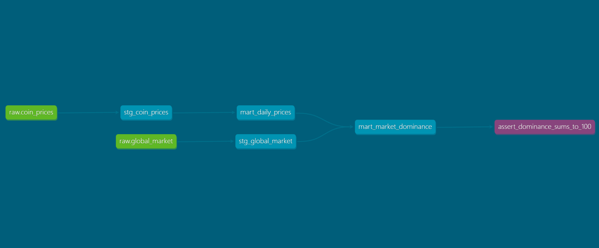

# Crypto Pipeline

A production-style data pipeline built with Python, PostgreSQL, dbt, and Airflow (coming Week 8-10).

## Architecture

```
CoinGecko API
    ├── /coins/markets  ──► Python ingestion ──► raw.coin_prices
    └── /global         ──► Python ingestion ──► raw.global_market
                                                        │
                                              dbt staging (views)
                                              stg_coin_prices
                                              stg_global_market
                                                        │
                                              dbt marts (tables)
                                              mart_daily_prices
                                              mart_top_movers
                                              mart_market_dominance
```

## Lineage graph



## Data sources

| Source | Endpoint | Frequency | Raw table |
|---|---|---|---|
| CoinGecko | /coins/markets | Daily | raw.coin_prices |
| CoinGecko | /global | Daily | raw.global_market |

## dbt models

| Model | Layer | Type | Description |
|---|---|---|---|
| stg_coin_prices | staging | view | Cleaned coin price snapshots |
| stg_global_market | staging | view | Cleaned global market snapshots |
| mart_daily_prices | marts | table | Daily OHLC + rolling avg + DoD change |
| mart_top_movers | marts | table | Top 5 gainers and losers per day |
| mart_market_dominance | marts | table | BTC/ETH dominance trend with prices |

## Data quality tests

- **not_null** on all key columns across all models
- **unique** on timestamp columns and market_date
- **accepted_values** on mover_type in mart_top_movers
- **assert_price_is_positive** — custom test: no coin price <= 0
- **assert_dominance_sums_to_100** — custom test: BTC+ETH dominance never exceeds 100.5%
- **source freshness** — warns if no new data in 25 hours, errors at 48 hours

## How to run

```powershell
# 1. Start the database (if not running)
docker start crypto-db

# 2. Activate virtual environment
venv\Scripts\activate

# 3. Run the ingestion pipeline
python main.py

# 4. Run dbt transformations and tests
cd crypto_transforms
dbt run && dbt test

# 5. Check source freshness
dbt source freshness

# 6. View documentation and lineage
dbt docs generate
dbt docs serve --port 8080
```

## Project structure

```
crypto-pipeline/
├── ingestion/
│   ├── coin_prices.py      # CoinGecko /coins/markets ingestion
│   └── global_market.py    # CoinGecko /global ingestion
├── crypto_transforms/      # dbt project
│   ├── models/
│   │   ├── staging/        # stg_* views — clean raw data
│   │   └── marts/          # mart_* tables — business logic
│   └── tests/              # custom singular tests
├── logs/                   # daily pipeline logs (gitignored)
├── images/                 # screenshots for README
├── db.py                   # shared DB connection
├── logger.py               # shared logging setup
└── main.py                 # pipeline entry point
```